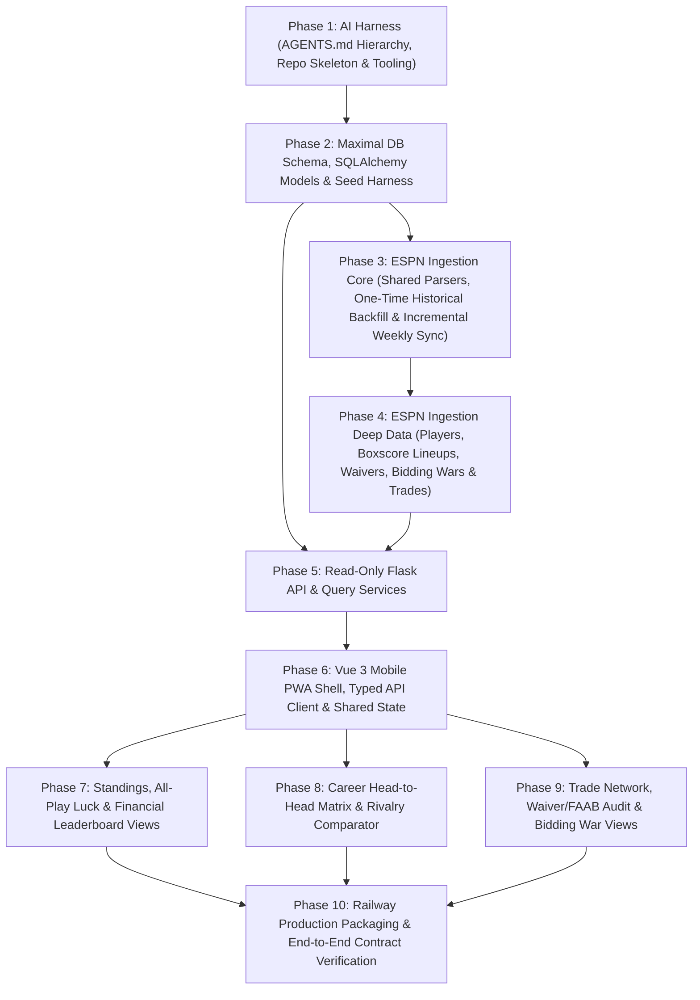

# Fantasy Football League Historian — Staff TL Architecture & AI-Agent Roadmap

> **Operating Mandate:** This repository is an **AI-Only Codebase**. Every line of code, test, migration, and documentation update will be authored and maintained by autonomous AI agents. As Staff TL, this document establishes the high-level architecture, maximal ESPN data ingestion strategy, AI codebase ergonomics, and bite-sized milestone roadmap so execution agents can work autonomously with minimal context overhead.

---

## 1. Architectural Review & High-Level Guardrails

The core architecture—a **strictly decoupled, read-only Flask/PostgreSQL API** paired with an **out-of-band ESPN ingestion layer** and a **mobile-first Vue 3 PWA**—is solid.

Because **changing the database schema after application code depends on it is expensive**, our #1 architectural priority is **Maximal Upfront ESPN Ingestion**: extracting and persisting *everything* ESPN's v3 API exposes on the first pass so future features (Trade Autopsies, Waiver ROI, All-Play Luck, Record Books, Player Profiles) never require schema surgery.

### Seven Critical Engineering Guardrails for Execution Agents

1. **Two-Tier Ingestion Architecture: One-Time Historical Backfill vs. Incremental Weekly Cron**
   - **Never re-fetch completed historical seasons in the weekly cron.** Historical seasons (`is_completed = TRUE`) are immutable on ESPN and require dozens of API calls per season (every week's boxscore + every scoring period's transactions).
   - **Workflow A — One-Time Historical Backfill (`backend/jobs/backfill_history.py`):** A CLI job run once (or at season rollover) that crawls all past seasons (`--from-year` to `--to-year` or auto-discovered), rate-limits politely, archives raw ESPN responses into `raw_espn_snapshots`, and populates all historical tables. Also supports `--from-snapshots` to rebuild tables purely from stored Postgres JSON snapshots with zero network calls.
   - **Workflow B — Incremental Weekly Cron (`backend/jobs/sync_weekly.py`):** The lightweight Railway Cron job (`0 10 * * 2,4`) that **only** queries the active season (`is_active = TRUE`) and syncs a **2-week rolling window** (`current_week - 1` and `current_week`). This finalizes last week's MNF scores, `$10` win payouts, Thursday NFL stat corrections, and the latest week's waiver/FAAB/trade activity in a few seconds, and automatically triggers podium payouts when the championship week finalizes (becoming a fast no-op in the offseason).
2. **PostgreSQL `NULL` Uniqueness & Stat Corrections (`earnings_ledger`)**
   - Standard SQL `UNIQUE (manager_id, season_year, week, entry_type)` treats `NULL != NULL`. Because season podium payouts have `week = NULL`, a naive constraint allows duplicate championship payouts on every run. Use Postgres 15+ `UNIQUE NULLS NOT DISTINCT` plus a partial unique index ensuring at most one weekly payout per `(manager_id, season_year, week)`.
   - Weekly ledger calculation in `sync_weekly.py` must **reconcile** a week's payouts rather than blindly appending (`ON CONFLICT DO NOTHING`), because Thursday NFL stat corrections can flip a Tuesday morning win or tie.
3. **Manager Identity Across Churn & Co-Owners (`managers` ↔ `teams`)**
   - Owners drop in and out across seasons, occasionally switch ESPN accounts, or co-own a franchise. `managers` must store `espn_member_id` (GUID from ESPN's `members`/`owners` payload), `teams` must support an optional `co_manager_id` (plus `raw_owner_guids JSONB`), and ingestion must check a declarative `db/manager_overrides.json` file for legacy overrides.
4. **Playoff Brackets, Consolation Games, Multi-Week Finals & Byes (`matchups`)**
   - ESPN returns Championship Bracket (`WINNERS_BRACKET`), Consolation Ladder (`WINNERS_CONSOLATION_LADDER`), Toilet Bowl (`LOSERS_CONSOLATION_LADDER`), and Bye weeks (`away_team = None`) in the same schedule feed, and some seasons use 2-week playoff rounds (`pointsByScoringPeriod`).
   - Make `away_team_id` and `winner_team_id` nullable, explicitly store `matchup_type`, and persist `points_by_scoring_period JSONB`. Only count `REGULAR` and `WINNERS_BRACKET` matchups in Career Head-to-Head, and use `teams.final_standing` (`rankCalculatedFinal`) for podium payouts.
5. **ESPN `mTransactions2` Deep Extraction & Bidding Wars**
   - Raw `mTransactions2` payloads only contain numeric `playerId`s and require explicit `x-fantasy-filter` headers per scoring period to surface failed waivers (`WAIVER_ERROR`).
   - Ingestion must resolve player IDs against a canonical `players` table, capture `related_espn_transaction_id` (which links losing waiver bids to the winning bid for **FAAB Bidding War** receipts, and deduplicates `TRADE_ACCEPT` vs `TRADE_UPHOLD`), and gracefully handle pre-2018 `leagueHistory` seasons where ESPN purged transaction logs.
6. **Cron Cadence vs. NFL Stat Corrections**
   - Schedule `sync_weekly.py` on Railway Cron for **both Tuesday and Thursday mornings (`0 10 * * 2,4`)**—Tuesday for post-MNF standings/payouts, and Thursday for Wednesday waiver processing + official NFL Elias stat corrections.
7. **PWA Service Worker vs. API Caching**
   - Static hashed assets use `CacheFirst`, while `/api/v1/*` routes must use `NetworkFirst` in Workbox and short `Cache-Control` TTLs in Flask so users immediately see fresh sync data when online while retaining full offline read capability.

---

## 2. Maximal ESPN Data Strategy

Storing only bare team totals and JSONB strings is limiting: rich historical features (**Trade Autopsies**, **Steals of the Wire / FAAB ROI**, **All-Play & Median Luck Index**, **Coaching Lineup Efficiency**, **Record Books**, and **Player Career Profiles**) all rely on **weekly player-level box scores** linked to **normalized player and transaction records**.

To ensure we never have to re-architect the database later, the ingestion layer and schema (`db/schema.sql`) must capture the following data domains from day one:

| Data Domain | ESPN API Views | What We Store Upfront | Future Features Unlocked |
| :--- | :--- | :--- | :--- |
| **1. Raw Payload Archive** (`raw_espn_snapshots`) | All views (`mSettings`, `mTeam`, `mStandings`, `mMatchupScore`, `mBoxscore`, `mRoster`, `mTransactions2`, `mDraftDetail`) | Immutable raw JSONB payload per `(season_year, view_name, scoring_period)` | Zero-network local re-parsing (`backfill_history.py --from-snapshots`) if we ever add new columns or if ESPN deprecates legacy endpoints |
| **2. League & Season Rules** (`seasons`) | `mSettings`, `mStatus` | `regular_season_weeks`, `playoff_team_count`, `playoff_matchup_length`, `scoring_type`, full `scoring_settings JSONB`, `roster_slots JSONB`, `faab_budget`, payouts, `has_transaction_data`, `has_boxscore_data` | Era-adjusted scoring context, Max PF / Optimal Lineup slot calculation |
| **3. Managers & Franchises** (`managers`, `teams`) | `mTeam`, `mStandings` | Human `managers` (`espn_member_id`); annual `teams` with `manager_id`, `co_manager_id`, division, W-L-T (overall/home/away/division), PF, PA, `streak_type`/`streak_length`, `playoff_seed`, `final_standing`, `faab_remaining`, `waiver_rank`, and official counts (`acquisitions`, `drops`, `trades`, `ir_moves`) | Manager churn tracking, co-owner support, Trophy Room banners, Points Titles, Playoff appearance streaks |
| **4. Canonical NFL Players** (`players`) | `kona_player_info`, `mBoxscore`, `mRoster` | `espn_player_id` (PK), `full_name`, `default_position`, `pro_team`, `headshot_url` | Cross-season player profiles (*"Who has rostered CMC the most?"*), player headshots everywhere |
| **5. Matchups & Weekly Team Metrics** (`matchups`) | `mMatchup`, `mMatchupScore`, `mBoxscore` | `matchup_type` (`REGULAR`, `WINNERS_BRACKET`, `WINNERS_CONSOLATION_LADDER`, `LOSERS_CONSOLATION_LADDER`, `BYE`), `home_score`/`away_score`, `home_projected`/`away_projected`, `home_optimal_score`/`away_optimal_score` (Max PF), `home_bench_points`/`away_bench_points`, `points_by_scoring_period JSONB` | **All-Play Record**, **Weekly Median Record**, **Schedule Luck ("Robbed vs. Lucky")**, **Bad Beats / Narrow Escapes Record Book** |
| **6. Weekly Player Lineups** (`weekly_lineups`) | `mBoxscore` (2019+), `mRoster` | Every rostered player per team per week: `player_id`, `slot_position` (`QB`, `RB`, `WR`, `TE`, `FLEX`, `D/ST`, `K`, `BE`, `IR`), `is_starter`, `actual_points`, `projected_points`, `acquisition_type`, `weekly_stats JSONB` | **Trade Autopsies** (actual starter points gained post-trade), **Waiver Wire ROI** (starter points per FAAB $), **Coach of the Year** (start/sit accuracy), **Position Crowns** |
| **7. Transactions, Bidding Wars & Trades** (`transactions`, `transaction_items`, `trades`) | `mTransactions2`, `kona_league_communication` | `transaction_type` (`FREE_AGENT`, `WAIVER`, `DROP`, `TRADE`), `status` (`EXECUTED`, `FAILED`, `CANCELED`, `VETOED`), `bid_amount`, `waiver_priority`, `failure_reason`, `proposed_at`, `executed_at`, `is_commissioner_override`, **`related_espn_transaction_id`**, JSONB summaries **plus** normalized `transaction_items` (`player_id`, `from_team_id`, `to_team_id`, `item_type`) | **FAAB Bidding War Receipts** (seeing every losing bid on a won player), **Trade Partner Networks** (`LEAST`/`GREATEST`), **Trade Heists / Autopsies** |
| **8. Financial Ledger** (`earnings_ledger`) | Derived from `matchups` + `teams.final_standing` | Reconciled `$10` regular-season wins, `$5` ties, and `CHAMPION` / `RUNNER_UP` / `THIRD_PLACE` payouts | All-time & seasonal bankroll leaderboards |

---

## 3. AI-Only Codebase Ergonomics ("Harness Engineering")

Because this codebase is built and evolved exclusively by AI agents across independent sessions, **context discoverability and automated self-verification** are mandatory.

### 3.1 Hierarchical `AGENTS.md` Context Map (Progressive Disclosure)
Agents must never waste tokens grepping the entire repository to understand conventions. We maintain a tiered `AGENTS.md` hierarchy:
- **`/AGENTS.md` (Root):** System map, service boundaries, golden rules, standard `make` verification commands, and handoff protocol.
- **`/db/AGENTS.md`:** PostgreSQL schema invariants, constraint rules (`NULLS NOT DISTINCT`), seed harness usage, and how to query derived metrics (All-Play, H2H, Trade Value).
- **`/backend/AGENTS.md`:** Flask read-only API rules, SQLAlchemy session rules, the separation between `backfill_history.py` (full historical crawl) and `sync_weekly.py` (incremental active-season rolling window), and offline fixture testing conventions.
- **`/frontend/AGENTS.md`:** Vue 3 `<script setup lang="ts">` patterns, mobile-first safe-area rules, Tailwind design tokens, and Workbox PWA caching rules.

### 3.2 AI-Friendly Repository Principles
1. **100% Offline Self-Verification:** Execution agents will not have live ESPN cookies or production DB credentials. The repo must include recorded ESPN API JSON fixtures (`backend/tests/fixtures/`) and a deterministic multi-season seed script (`db/seed_dev.py`) so any agent can verify backfill, incremental weekly sync, API queries, and UI rendering locally.
2. **Small, Single-Responsibility Modules:** Keep files under ~250 lines with a concise top-of-file docstring stating *purpose*, *inputs/outputs*, and *invariants*.
3. **Shared Contract Truth (`docs/api-contracts.md`) & Lightweight ADRs (`docs/adr/`):** Backend and frontend agents coordinate exclusively through `docs/api-contracts.md` and `src/types/api.ts`, logging non-trivial design choices in `docs/adr/`.

---

## 4. Bite-Sized Agent Execution Roadmap

Each phase is scoped for a single AI agent session. Every agent must:
1. Read `/AGENTS.md` and `ROADMAP.md`.
2. Execute only its assigned phase.
3. Run all verification checks until green.
4. Update the phase status in `ROADMAP.md` (and any relevant domain `AGENTS.md` / `docs/api-contracts.md`) before finishing.

---

### Phase 1: AI Harness (`AGENTS.md` Hierarchy), Repo Skeleton & Tooling Setup
- **Status:** `[x] Completed`
- **Objective:** Prepare the repository for autonomous multi-agent development by establishing the directory skeleton, the hierarchical `AGENTS.md` files, local Docker Postgres setup, and unified verification commands.
- **Deliverables:**
  - Root `AGENTS.md` + domain-specific `db/AGENTS.md`, `backend/AGENTS.md`, and `frontend/AGENTS.md`.
  - `docs/api-contracts.md` (initial canonical REST endpoint & JSON contract specification) and `docs/adr/001-maximal-espn-ingestion.md`.
  - Updated `.gitignore` (Python + Node/Vite/PWA), `.env.example`, and `docker-compose.yml` (local PostgreSQL 16).
  - `backend/` Python project configuration (`pyproject.toml`, `requirements.txt`, `ruff`, `pytest`) and root `Makefile` exposing standard agent commands (`make lint`, `make test`, `make seed`, `make backfill`, `make sync-weekly`, `make build`).
- **Definition of Done:**
  - Any future agent landing in the repo can read `/AGENTS.md`, run `make lint` and `make test`, and immediately understand where files live and how to verify changes.

---

### Phase 2: Maximal Database Schema, SQLAlchemy Models & Offline Seed Harness
- **Status:** `[x] Completed`
- **Objective:** Implement the full PostgreSQL schema (`db/schema.sql`), SQLAlchemy 2.0 models (`backend/models/`), connection pooling (`backend/database.py`), and a rich multi-season seed script (`db/seed_dev.py`) covering all 8 data domains in Section 2.
- **Deliverables:**
  - `db/schema.sql` and `backend/models/` covering:
    - `raw_espn_snapshots`, `seasons`, `managers`, `teams`, `players`, `matchups`, `weekly_lineups`, `transactions`, `transaction_items`, `trades`, `earnings_ledger`, and `sync_runs` (tracking `run_type` = `'BACKFILL'` vs `'WEEKLY_CRON'`, `season_year`, `week_range`).
  - `db/seed_dev.py` generating 3 realistic seasons of data (including manager churn across years, weekly starter/bench lineups, projected & optimal scores, ties, playoff/consolation brackets, weekly/podium payouts, executed/failed FAAB bidding wars linked via `related_espn_transaction_id`, and trades).
  - Model constraint & idempotency unit tests (`backend/tests/test_models.py`).
- **Definition of Done:**
  - `pytest` verifies all schema constraints (including duplicate podium/weekly ledger rejection and foreign keys) and `db/seed_dev.py` runs idempotently.

---

### Phase 3: ESPN Ingestion Engine — Part 1 (Shared Core, One-Time Historical Backfill & Incremental Weekly Cron)
- **Status:** `[x] Completed`
- **Objective:** Build the two-tier ingestion architecture separating the **One-Time Historical Backfill (`backfill_history.py`)** from the **Incremental Weekly Cron (`sync_weekly.py`)**, sharing pure domain parsers for seasons, managers, teams, matchups, and the financial ledger.
- **Deliverables:**
  - **Shared Client & Pure Parsers (`backend/jobs/espn_client.py`, `backend/jobs/parsers.py`, `backend/jobs/ledger_reconciler.py`):**
    - Manager identity resolver supporting `espn_member_id` GUIDs, co-owners, and `db/manager_overrides.json`.
    - Season settings, team standings, and matchup parsers (regular season, championship playoffs, consolation ladders, multi-week playoff periods, and bye weeks).
    - Idempotent earnings reconciler (`$10` regular-season win, `$5` tie split, `1st/2nd/3rd` podium payouts when `is_completed = TRUE`) that cleanly handles stat-correction flips.
  - **One-Time Historical Backfill (`backend/jobs/backfill_history.py`):**
    - Crawls all historical seasons (`--from-year` to `--to-year` or auto-discovered), archives every raw response into `raw_espn_snapshots`, and supports `--from-snapshots` for offline database rebuilds without hitting ESPN.
  - **Incremental Weekly Cron (`backend/jobs/sync_weekly.py`):**
    - Targets **only** the active season (`is_active = TRUE`) and syncs a **rolling window (`current_week - 1` and `current_week`)** (plus an optional `--week N` override). Automatically transitions the season to `is_completed = TRUE` and triggers podium payouts once the championship week finalizes, and exits immediately as a no-op during the offseason.
- **Definition of Done:**
  - Offline `pytest` suite verifies both `backfill_history.py` (multi-season full crawl + snapshot replay) and `sync_weekly.py` (incremental 2-week rolling window, Thursday stat-correction flip, and season-end podium transition) with zero duplicates.

---

### Phase 4: ESPN Ingestion Engine — Part 2 (Players, Weekly Boxscore Lineups, Waivers, Bidding Wars & Trades)
- **Status:** `[x] Completed`
- **Objective:** Plug deep player, weekly boxscore lineup (`mBoxscore`), and transaction/trade (`mTransactions2`) extraction into both `backfill_history.py` (all weeks/scoring periods) and `sync_weekly.py` (only the rolling active weeks/scoring periods).
- **Deliverables:**
  - Canonical `players` upserter (`espn_player_id`, `full_name`, `default_position`, `pro_team`, `headshot_url`).
  - Weekly boxscore lineup parser (`weekly_lineups`) recording every starter, bench, and IR slot (`actual_points`, `projected_points`, `weekly_stats JSONB`) and computing team `optimal_score` (Max PF) and `bench_points` on `matchups`.
  - `mTransactions2` parser capturing free agents, executed waivers, failed waiver bids (`WAIVER_ERROR` with normalized failure reasons and `related_espn_transaction_id` linking losing bids to the winning claim), drops, and deduplicated trades—populating both JSONB summaries and normalized `transaction_items`.
  - Scoped execution: `backfill_history.py` pulls all weeks `1..total_weeks` and scoring periods `0..max_scoring_period`, while `sync_weekly.py` only pulls boxscores and scoring periods for the active rolling window (`current_week - 1` to `current_week`).
- **Definition of Done:**
  - `pytest` verifies full-season backfill and incremental weekly delta sync for player dimensions, starter/bench lineups, optimal lineup calculations, FAAB bidding war links, and trades.

---

### Phase 5: Read-Only Flask REST API, Query Services & Contract Documentation
- **Status:** `[x] Completed`
- **Objective:** Expose the read-only JSON REST endpoints powered by SQLAlchemy query services and Gunicorn `gthread` configuration.
- **Deliverables:**
  - Query services (`backend/services/`) and Flask blueprints (`backend/routes/`) for:
    - `GET /api/v1/meta` & `GET /api/v1/health` (seasons, active/historical managers, last backfill & weekly sync status, data availability flags)
    - `GET /api/v1/earnings/leaderboard` (all-time & seasonal bankroll, weekly vs podium split, trophy counts)
    - `GET /api/v1/standings/current` (supports `?season={year}`; includes official records, PF/PA, All-Play record, Weekly Median record, Luck index, bench/optimal efficiency, and weekly cash won)
    - `GET /api/v1/history/head-to-head` (supports pairwise `?managerA=&managerB=` and full league N×N rivalry matrix)
    - `GET /api/v1/trades/trends` (normalized `LEAST`/`GREATEST` trade partner pairs, active traders, trade history with post-trade starter points gained)
    - `GET /api/v1/transactions/summary?season={year}` (FAAB efficiency, waiver success/fail rates, failure reason breakdown, bidding war receipts, and transaction feed)
  - `Cache-Control` middleware, Gunicorn config (`2 workers, 4 gthreads`), `backend/tests/test_api_routes.py`, and updated `docs/api-contracts.md`.
- **Definition of Done:**
  - `pytest` validates all endpoints, derived stats, and cache headers against seeded data; `docs/api-contracts.md` is complete and accurate.

---

### Phase 6: Frontend Mobile-First PWA Shell, Typed API Client & Navigation
- **Status:** `[x] Completed`
- **Objective:** Scaffold the `frontend/` Vue 3 + Vite + TypeScript + Tailwind CSS + `vite-plugin-pwa` client and mobile application shell.
- **Deliverables:**
  - Strict TypeScript interfaces (`src/types/api.ts`) mirroring `docs/api-contracts.md` and a typed fetch client (`src/api/client.ts`).
  - Global league metadata composable (`useLeagueMeta`) hydrated from `/api/v1/meta`.
  - Mobile-first app shell: `TopHeader` (sync status + season selector), `BottomNav` (5 tabs with iOS safe-area insets), and reusable touch `SwipeDrawer` + loading/empty state components.
  - Workbox PWA configuration (`NetworkFirst` for `/api/v1/*`, `CacheFirst` for static assets).
- **Definition of Done:**
  - `vue-tsc --noEmit` and `vite build` pass with zero errors and generate valid PWA manifest and service worker bundles.

---

### Phase 7: Standings, All-Play Luck & Financial Earnings Leaderboard Views
- **Status:** `[x] Completed`
- **Objective:** Implement the **Standings** and **Earnings Leaderboard** mobile screens.
- **Deliverables:**
  - `StandingsView.vue`: Current/historical season standings with W-L-T, PF/PA, All-Play & Luck indicators, weekly `$10` cash won badges, and podium indicators.
  - `EarningsView.vue`: All-time and seasonal financial rankings comparing weekly win cash vs. podium cash, with a swipeable manager detail drawer showing season-by-season payout history and trophies.
- **Definition of Done:**
  - Views cleanly consume `/api/v1/standings/current` and `/api/v1/earnings/leaderboard`, handle loading/error states, and pass `vue-tsc` + `vite build`.

---

### Phase 8: Career Head-to-Head Matrix & Rivalry Comparator View
- **Status:** `[x] Completed`
- **Objective:** Implement the **Head-to-Head History** screen combining a league-wide N×N rivalry matrix and a 1-on-1 manager comparator.
- **Deliverables:**
  - `HeadToHeadView.vue` + child components:
    - Interactive N×N career win-rate matrix where tapping any cell selects that manager pair.
    - 1-on-1 Tale of the Tape view showing career series record (regular season vs championship playoffs), total points/differential, streaks, biggest blowout/closest game, and scrollable matchup history.
- **Definition of Done:**
  - Consumes `/api/v1/history/head-to-head`, supports both matrix overview and pairwise deep dive, and passes `vue-tsc` + `vite build`.

---

### Phase 9: Trade Network, Waiver/FAAB Audit & Bidding War Views
- **Status:** `[x] Completed`
- **Objective:** Implement the **Trade Trends** and **Transactions / Waiver Audit** screens.
- **Deliverables:**
  - `TradesView.vue`: Visualizes top trading partner pairs (`LEAST`/`GREATEST` alliances), most active traders, and chronological trade cards showing player headshots and post-trade realized points.
  - `WaiversView.vue`: Displays manager FAAB efficiency, waiver success/failure rates, and a filterable transaction audit feed highlighting **failed waiver bids** (`$FAAB` bid amount + failure reason badge + bidding war breakdown against the winning claim).
- **Definition of Done:**
  - Consumes `/api/v1/trades/trends` and `/api/v1/transactions/summary`, handles pre-2018 seasons lacking transaction data gracefully, and passes `vue-tsc` + `vite build`.

---

### Phase 10: Railway Production Packaging & End-to-End Contract Verification
- **Status:** `[x] Completed`
- **Objective:** Package the 4 Railway services (PostgreSQL, Gunicorn API, NGINX Frontend PWA, and the Incremental Weekly Cron Worker) plus one-time backfill runbook, and execute an automated end-to-end contract verification suite.
- **Deliverables:**
  - Production `backend/Dockerfile` (supporting `gunicorn` for the API service, `python -m backend.jobs.sync_weekly` for the Railway Cron service, and `python -m backend.jobs.backfill_history` for one-time historical seeding) and `frontend/Dockerfile` + `frontend/nginx.conf`.
  - End-to-end smoke test (`backend/tests/test_e2e_smoke.py`) verifying historical backfill -> weekly incremental sync -> API responses -> TypeScript contract alignment.
  - Finalized `README.md` and `AGENTS.md` for ongoing autonomous maintenance.
- **Definition of Done:**
  - All backend tests, E2E smoke checks, linters, and frontend production builds pass via a single command (`make check` / `make test`).
