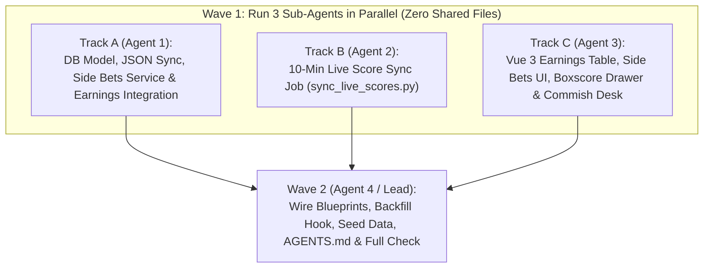

# Side Bets Architecture & Parallel Multi-Agent Execution Plan

> **Canonical Reference (`docs/SIDE_BETS_PLAN.md`):** This document is the single source of truth for adding **Side Bets** (1v1 and multi-team $N \text{ vs. } M$ group matchups with point spreads, positive/negative earnings ledger integration, live 10-minute ESPN player scoring, expandable team/player boxscores, and a Commissioner Side Bet Desk) to the Fantasy Football League Historian app.
>
> **Parallel Execution Ready:** The work is partitioned into **strictly non-overlapping file ownership boundaries** and a **frozen upfront API & Schema contract** so multiple AI agents can run simultaneously without merge conflicts.

---

## 1. Product & Architectural Decisions

### 1.1 Where Do Side Bets Live & How Do They Show Up in Earnings?
- **No 6th Bottom Nav Tab:** [`BottomNav.vue`](../frontend/src/components/layout/BottomNav.vue) remains strictly at 5 primary tabs (`Standings`, `Earnings`, `Hall of Fame`, `Trades`, `Drafts`) to preserve 44×44px mobile touch targets on 375px screens.
- **Segmented Tab Control inside Earnings (`EarningsView.vue`):**
  - **Tab 1 — `Earnings` (`?tab=standings`):** The main financial scoreboard (`EarningsScoreboardTable.vue`) where **Side Bets Net Cash** (`+$40` or `-$20`) is directly integrated alongside League Prize Cash (`Wins`, `Bonus`, `Podium`) and factors into `total_earnings`!
  - **Tab 2 — `Side Bets` (`?tab=side-bets`):** Weekly & seasonal side bet matchup cards (`SideBetCard.vue`), a week selector pill bar (defaulting to the active week with a pulsing emerald `LIVE` indicator), and the expandable player/team boxscore drawer (`SideBetDetailDrawer.vue`).
  - **Header Button — `Commish` (`?tab=admin`):** Password-protected **Commissioner Side Bet Desk** reusing the existing commissioner secret (`X-Admin-Password` / `sessionStorage.getItem('ff_trade_admin_password')`).

---

### 1.2 Backend Architecture Deep Dive: DB Schema, `earnings_ledger` vs. `side_bets`, & Backfill Logic

#### Q: Does this change our DB schema?
**Yes — strictly additively (1 new table: `side_bets`), with zero breaking changes to the existing 14 tables.**
- **Why we do NOT store side bets inside `earnings_ledger`:**
  1. `earnings_ledger` has a strict uniqueness constraint: `UNIQUE NULLS NOT DISTINCT (manager_id, season_year, week, entry_type)`. A manager can easily participate in *multiple* side bets in the same week (e.g., a 1v1 side bet AND a 3v3 division side bet in Week 5), which would violate `(manager_id, season_year, week, 'SIDE_BET')` uniqueness.
  2. `earnings_ledger` is strictly reconciled from ESPN data by `ledger_reconciler.py` (`WEEKLY_WIN`, `WEEKLY_TIE`, `WEEKLY_HIGH_SCORE`, `WEEKLY_HIGH_SCORE_LOSS`, `CHAMPION`, etc.). Mixing commissioner-authored peer-to-peer wagers into `earnings_ledger` would complicate stat-correction reconciliation.
  3. A side bet is a **multi-team relational entity** ($N \text{ vs. } M$ teams, `spread_side_a`, `stake_amount`, `title`) whose winner is dynamically determined by the sum of `weekly_lineups` starter points plus the spread.
- **How `earnings_service.py` integrates Side Bets cleanly at read-time:**
  - `side_bets` stores the canonical bet definition (`season_year`, `week`, `side_a_espn_team_ids`, `side_b_espn_team_ids`, `spread_side_a`, `stake_amount`).
  - When `/api/v1/earnings/leaderboard` runs, `earnings_service.py` calls a helper in `side_bets_service.py` (`compute_manager_side_bet_Rollups(session, season_filter)`) that evaluates all completed side bets against the already-loaded `weekly_lineups` / `matchups` scores and attaches `side_bets_cash` (`+$20` / `-$20`), win/loss/push counts, and `side_bet_receipts` directly onto each manager's season breakdown and career total!
  - Because `weekly_lineups` and `matchups` are automatically updated by Thursday NFL stat corrections in `sync_weekly.py`, **any stat correction that flips a side bet's spread outcome automatically flips the manager's `+$20` / `-$20` side bet earnings without needing manual ledger surgery!**

#### Q: Does this change our `backfill_history.py` or `sync_weekly.py` logic?
**`backfill_history.py` and `sync_weekly.py` already ingest 100% of the ESPN data needed (`mBoxscore` $\rightarrow$ `weekly_lineups` and `matchups`), so ESPN crawling/parsing logic does NOT need to change!**
- However, there is **one critical persistence invariant** we must follow (the exact same pattern used for `trade_overrides` in [`backend/jobs/parsers.py`](../backend/jobs/parsers.py#L41-L185)):
  - Because `SideBet` records are created by the Commissioner (not scraped from ESPN), if you ever drop and rebuild your SQLite/Postgres database from `raw_espn_snapshots` (`make backfill`), a naive DB-only table would lose your side bets, and internal auto-increment `teams.id` primary keys could shift.
  - **Solution:**
    1. `side_bets` stores **canonical ESPN franchise slot IDs** (`side_a_espn_team_ids: [1, 4]`, `side_b_espn_team_ids: [2, 7]`, where `espn_team_id` is always `1..12` in ESPN) rather than volatile internal `teams.id` integers.
    2. Whenever the Commissioner creates, updates, or deletes a side bet via `/api/v1/side-bets`, the backend writes to both the `side_bets` SQL table **and** `db/side_bets.json`.
    3. Both `init_db()` (in `backend/database.py`) and `backfill_history()` (in `backend/jobs/backfill_history.py`) call `sync_side_bets_to_db(session)` so commissioner side bets are **100% indestructible across database resets and snapshot backfills**.

---

### 1.3 Positive & Negative Side Bet Earnings + Mobile Viewport Preservation (`375px`)
When a completed side bet has a `stake_amount > 0`:
- Every franchise on the **winning side** earns **`+stake_amount`** (e.g. `+$20`).
- Every franchise on the **losing side** incurs **`-stake_amount`** (e.g. `-$20`).
- If the bet finishes in an exact spread tie (`PUSH`) or is still in-progress (`!is_completed`), net impact is `$0`.
- A manager's `total_earnings` (Season Total / All-Time Bankroll) includes `side_bets_cash`, meaning a manager who won `$10` in weekly wins but lost a `$20` side bet can have a **negative** `side_bets_cash` (`-$20`) and even a negative `total_earnings` (`-$10`).

#### How We Fit `Side Bets` into `EarningsScoreboardTable.vue` Without Breaking Mobile (`375px`)
Let's look at the current CSS grid in [`EarningsScoreboardTable.vue`](../frontend/src/components/earnings/EarningsScoreboardTable.vue#L39-L43):
- Currently on mobile (`<640px`), Single-Season mode uses `grid-cols-[20px_1fr_46px_44px_52px]` (`#`, `Franchise`, `Wins`, `Bonus`, `Total`), which leaves ~`195px` for the franchise avatar + name on a `375px` screen.
- **Mobile-Safe Column Strategy (`<640px` vs `sm: >=640px`):**
  1. **Desktop / Tablet (`sm:` and up):** Add a dedicated sortable **`Bets`** column right before `Total` / `Bankroll`:
     - Single Season (`sm:` completed): `sm:grid-cols-[28px_1fr_54px_58px_58px_62px_72px]` (`#`, `Franchise`, `Wins`, `Bonus`, `Bets`, `Podium`, `Total`)
     - Single Season (`sm:` in-progress): `sm:grid-cols-[28px_1fr_58px_60px_60px_76px]` (`#`, `Franchise`, `Wins`, `Bonus`, `Bets`, `Total`)
     - All-Time (`sm:`): `sm:grid-cols-[28px_1fr_52px_58px_58px_62px_68px_76px]` (`#`, `Franchise`, `Wins`, `Bonus`, `Bets`, `Podium`, `Titles`, `Bankroll`)
  2. **Mobile (`<640px` — 375px iPhone SE safe):**
     - **Single-Season Mode:** Use compact tabular widths `grid-cols-[18px_1fr_38px_38px_42px_48px]` (`#`, `Franchise`, `Wins`, `Bonus`, `Bets`, `Total`) with `px-2` row padding so `Franchise` retains `160px+` and never overflows horizontally on a `375px` screen.
     - **All-Time Mode:** Keep the `Bets` column `hidden sm:block` on mobile (just like `Bonus` and `Podium` are already `hidden sm:block` on mobile in All-Time mode), and show a compact inline pill (e.g. `+$40 Bets` in emerald or `-$20 Bets` in rose coral) in the manager subtitle row when `(entry.side_bets_cash ?? 0) !== 0`!
  3. **Negative Currency Formatting Helper (`formatSignedCash` / `formatCash`):**
     - Standard positive/zero amounts render as `$20` (or `+$20` in the `Bets` column).
     - Negative amounts render as `-$20` (with minus sign *before* the dollar sign, never `$-20`) and style in **Alert Coral (`text-rose-400`)** so losses immediately pop against emerald (`text-emerald-400`) wins.
  4. **Manager Detail Drawer (`EarningsDetailDrawer.vue`):**
     - Expand the top summary strip from 3 boxes to 4 boxes (`grid-cols-2 sm:grid-cols-4`: `Wins Cash`, `Bonus Cash`, `Side Bets`, `Podium Cash`).
     - Add an itemized **"Side Bets History"** card in the drawer showing each week's side bet (`Wk 4 · West vs East (-6.5) · WON +$20` in emerald or `LOST -$20` in rose).

---

### 1.4 Group vs. Group Matchups, Point Spreads & Expandable Team/Player Boxscores
- **Flexible $N \text{ vs. } M$ Team Groups:**
  - Any side bet pits **Side A** (1 or more franchises in that season) against **Side B** (1 or more franchises in that season) for a specific `(season_year, week)`.
  - Supports 1v1 rivalries, 2v2 tag teams, 3v3 division wars, or handicap 1v2 matchups.
- **Point Spread Math:**
  - Stored as `spread_side_a` (numeric in `0.5` or `0.01` increments, e.g., `-7.5` means Side A is favored by 7.5 points; `+10.5` means Side A gets 10.5 points).
  - Each side's raw score is the sum of its participating teams' starter points (`weekly_lineups.is_starter = TRUE`):
    $$\text{Side A Raw} = \sum_{t \in \text{Side A}} \text{StarterPoints}(t), \qquad \text{Side B Raw} = \sum_{t \in \text{Side B}} \text{StarterPoints}(t)$$
    $$\text{Side A Adjusted} = \text{Side A Raw} + \text{spread\_side\_a}$$
    $$\text{Margin vs. Spread} = \text{Side A Adjusted} - \text{Side B Raw}$$
  - **Verdict:**
    - $\text{Margin vs. Spread} > 0 \implies$ **Side A Covers (`"A"`)**
    - $\text{Margin vs. Spread} < 0 \implies$ **Side B Covers (`"B"`)**
    - $\text{Margin vs. Spread} = 0 \implies$ **Push (`"PUSH"`)**
- **Page-Up / Expandable Boxscore Grouped by Team (`SideBetDetailDrawer.vue`):**
  - Tapping any `SideBetCard.vue` (or its *"Players & Points"* button) opens a bottom-sheet drawer powered by [`SwipeDrawer.vue`](../frontend/src/components/ui/SwipeDrawer.vue).
  - Inside the drawer, **Side A** and **Side B** list each participating franchise in its own collapsible team section (showing team avatar, manager name, team subtotal, and team projected subtotal).
  - Under each team, every starting player is listed in canonical slot order (`QB`, `RB`, `WR`, `TE`, `FLEX`, `D/ST`, `K`) with player headshot, NFL team, injury badge, projected points, and live actual points (`font-mono tabular-nums`), plus an expandable **Bench (`BE` / `IR`)** section per team.

---

### 1.5 Lightweight 10-Minute Live In-Week Script (`backend/jobs/sync_live_scores.py`)
- `sync_weekly.py` is too heavy for 10-minute polling because it crawls a 2-week rolling window, fetches `mTransactions2` with waiver filters, queries league communication topics, reconciles financial ledgers, and downloads binary media assets.
- `backend/jobs/sync_live_scores.py` is purpose-built for a 10-minute cron (`*/10 * * * 0,1,4,6` on NFL game days):
  - Queries `seasons` for `is_active = TRUE` (exits in `<50ms` with 0 network calls during the offseason).
  - Makes **1 HTTP GET** to ESPN for `scoringPeriodId = active_season.current_week` with `views=["mBoxscore", "mMatchupScore"]`.
  - Updates **only** `matchups` (live scores/projections) and `weekly_lineups` (live player `actual_points`, `projected_points`, `slot_position`, `is_starter`, `weekly_stats`) for `current_week`.
  - Logs a `SyncRun(run_type="LIVE_SCORES")` and exposes `make sync-live` and `POST /api/v1/admin/sync-live`.

---

## 2. Frozen Shared Contracts (Read Before Starting Any Track)

To allow **Track A**, **Track B**, and **Track C** to run **100% in parallel**, all agents MUST implement against the exact SQL schema and JSON/TypeScript contract below.

### 2.1 Database Table Contract (`side_bets`)
```sql
CREATE TABLE IF NOT EXISTS side_bets (
    id SERIAL PRIMARY KEY,
    bet_uuid VARCHAR(64) UNIQUE NOT NULL,
    season_year INT NOT NULL,
    week INT NOT NULL,
    title VARCHAR(128) NOT NULL DEFAULT '',
    side_a_name VARCHAR(64) NOT NULL DEFAULT 'Side A',
    side_b_name VARCHAR(64) NOT NULL DEFAULT 'Side B',
    side_a_espn_team_ids JSONB NOT NULL DEFAULT '[]'::jsonb,
    side_b_espn_team_ids JSONB NOT NULL DEFAULT '[]'::jsonb,
    spread_side_a NUMERIC(6,2) NOT NULL DEFAULT 0.00,
    stake_amount NUMERIC(10,2) NOT NULL DEFAULT 0.00,
    stake_description VARCHAR(128) NOT NULL DEFAULT '',
    scoring_mode VARCHAR(16) NOT NULL DEFAULT 'STARTERS',
    is_deleted BOOLEAN NOT NULL DEFAULT FALSE,
    created_at TIMESTAMPTZ NOT NULL DEFAULT NOW(),
    updated_at TIMESTAMPTZ NOT NULL DEFAULT NOW()
);

CREATE INDEX IF NOT EXISTS idx_side_bets_season_week ON side_bets(season_year, week);
```

### 2.2 Additions to Existing `EarningsLeaderboardEntry` & `ManagerSeasonBreakdown`
In `backend/services/earnings_service.py` and `frontend/src/types/api.ts`, add the following fields (defaulting to `0` / `[]` when a manager has no side bets):

```typescript
export interface ManagerSideBetReceipt {
  bet_id: number;
  season_year: number;
  week: number;
  title: string;
  opponent_label: string;
  spread_applied: number;
  team_side_points: number;
  opponent_side_points: number;
  result: "WIN" | "LOSS" | "PUSH";
  amount: number; // +stake_amount on WIN, -stake_amount on LOSS, 0 on PUSH
}

// Added to ManagerSeasonBreakdown:
//   side_bets_cash: number;        // Net + / - cash from completed side bets in this season
//   side_bets_wins: number;
//   side_bets_losses: number;
//   side_bets_pushes: number;
//   side_bet_receipts?: ManagerSideBetReceipt[];
//   (Note: ManagerSeasonBreakdown.total_earnings = weekly_earnings + podium_earnings + points_title_cash + side_bets_cash)

// Added to EarningsLeaderboardEntry:
//   side_bets_cash: number;        // Net + / - cash across selected scope
//   side_bets_wins_count: number;
//   side_bets_losses_count: number;
//   side_bets_pushes_count: number;
//   side_bet_receipts?: ManagerSideBetReceipt[];
//   (Note: EarningsLeaderboardEntry.total_earnings = weekly_earnings + podium_earnings + points_title_cash + side_bets_cash)
```

### 2.3 Dedicated Side Bets REST API & TypeScript Contract (`/api/v1/side-bets/*`)

#### Endpoints
- `GET /api/v1/side-bets?season={year}&week={week}`
  - Returns `SideBetsResponse`. If `season` is omitted, defaults to active/latest season (or all seasons when `season=all`). If `week` is omitted, returns all weeks for the selected scope and sets `selected_week` to the active/latest week with bets.
- `POST /api/v1/side-bets` (Requires `X-Admin-Password` header)
  - Body: `SideBetCreatePayload` $\rightarrow$ Returns `{ "message": "Side bet created", "bet_id": number, "bet_uuid": string }` (`201`).
- `PUT /api/v1/side-bets/<int:bet_id>` (Requires `X-Admin-Password` header)
  - Body: `SideBetUpdatePayload` $\rightarrow$ Returns `{ "message": "Side bet updated", "bet_id": number }` (`200`).
- `DELETE /api/v1/side-bets/<int:bet_id>` (Requires `X-Admin-Password` header)
  - Soft-deletes (`is_deleted = True`) and syncs `db/side_bets.json` $\rightarrow$ Returns `{ "message": "Side bet deleted", "bet_id": number }` (`200`).

#### Canonical TypeScript Interfaces
```typescript
export type SideBetScoringMode = "STARTERS" | "MAX_PF" | "BENCH";
export type SideBetWinner = "A" | "B" | "PUSH" | null;

export interface SideBetPlayerEntry {
  player_id: number;
  full_name: string;
  default_position: string;
  pro_team: string;
  headshot_url: string | null;
  slot_position: string;
  is_starter: boolean;
  actual_points: number;
  projected_points: number;
  injury_status: string | null;
  is_injured: boolean;
}

export interface SideBetTeamBreakdown {
  team_id: number;
  espn_team_id: number;
  team_name: string;
  team_abbrev: string | null;
  logo_url: string | null;
  manager_id: number;
  manager_name: string;
  starter_points: number;
  projected_points: number;
  bench_points: number;
  optimal_points: number;
  effective_points: number;
  starters: SideBetPlayerEntry[];
  bench: SideBetPlayerEntry[];
}

export interface SideBetSideSummary {
  side_label: "A" | "B";
  side_name: string;
  espn_team_ids: number[];
  teams: SideBetTeamBreakdown[];
  raw_points: number;
  projected_points: number;
  bench_points: number;
  spread_applied: number; // spread_side_a for Side A, -spread_side_a for Side B
  adjusted_points: number; // raw_points + spread_side_a for Side A; raw_points for Side B
  projected_adjusted_points: number;
}

export interface SideBetDetail {
  bet_id: number;
  bet_uuid: string;
  season_year: number;
  week: number;
  title: string;
  scoring_mode: SideBetScoringMode;
  spread_side_a: number;
  stake_amount: number;
  stake_description: string;
  is_completed: boolean;
  is_live: boolean;
  side_a: SideBetSideSummary;
  side_b: SideBetSideSummary;
  margin_vs_spread: number; // round(side_a.adjusted_points - side_b.raw_points, 2)
  projected_margin_vs_spread: number;
  currently_covering: SideBetWinner;
  winning_side: SideBetWinner; // Only finalized when is_completed === true, else null
}

export interface SideBetManagerStanding {
  manager_id: number;
  manager_name: string;
  team_name: string;
  avatar_url: string | null;
  bets_count: number;
  wins: number;
  losses: number;
  pushes: number;
  pending: number;
  net_earnings: number;
  total_staked: number;
}

export interface SideBetsResponse {
  season_filter: number | null;
  selected_week: number | null;
  current_week: number;
  available_weeks: number[];
  last_live_sync_at: string | null;
  bets: SideBetDetail[];
  leaderboard: SideBetManagerStanding[];
}

export interface SideBetCreatePayload {
  season_year: number;
  week: number;
  title?: string;
  side_a_name?: string;
  side_b_name?: string;
  side_a_team_ids: number[]; // Accepts internal team_id or espn_team_id
  side_b_team_ids: number[];
  spread_side_a: number;
  stake_amount?: number;
  stake_description?: string;
  scoring_mode?: SideBetScoringMode;
}

export type SideBetUpdatePayload = Partial<SideBetCreatePayload>;
```

---

## 3. Parallel Execution Tracks & File Ownership Matrix



### File Ownership Matrix (Strict Lock Rules for Wave 1)
To prevent merge conflicts when running Wave 1 agents in parallel, each agent **MUST ONLY** create or edit files in its own column:

| Track | Owned Files (Create / Edit Freely) | Off-Limits in Wave 1 (Deferred to Wave 2) |
| :--- | :--- | :--- |
| **Track A: Backend Data, Earnings Ledger & API** | • `backend/models/side_bet.py` *(new)*<br/>• `backend/services/side_bets_service.py` *(new)*<br/>• `backend/services/earnings_service.py` *(edit)*<br/>• `backend/routes/side_bets.py` *(new)*<br/>• `db/side_bets.json` *(new)*<br/>• `backend/tests/test_side_bets_api.py` *(new)* | Do **not** edit `backend/app.py`, `backend/routes/__init__.py`, `backend/models/__init__.py`, `db/schema.sql`, or `db/seed_dev.py` in Wave 1. (In `test_side_bets_api.py`, register `side_bets_bp` on the test app or import `SideBet` directly so tests pass standalone). |
| **Track B: 10-Min Live Sync Script** | • `backend/jobs/sync_live_scores.py` *(new)*<br/>• `backend/routes/admin.py` *(edit)*<br/>• `backend/services/meta_service.py` *(edit)*<br/>• `Makefile` *(edit)*<br/>• `backend/tests/test_sync_live_scores.py` *(new)* | Do **not** edit `backfill_history.py`, `sync_weekly.py`, or any frontend files. |
| **Track C: Frontend UI & Commish Desk** | • `frontend/src/types/api.ts` *(edit)*<br/>• `frontend/src/api/client.ts` *(edit)*<br/>• `frontend/src/views/EarningsView.vue` *(edit)*<br/>• `frontend/src/components/earnings/EarningsScoreboardTable.vue` *(edit)*<br/>• `frontend/src/components/earnings/EarningsDetailDrawer.vue` *(edit)*<br/>• `frontend/src/components/earnings/SideBetsSection.vue` *(new)*<br/>• `frontend/src/components/earnings/SideBetCard.vue` *(new)*<br/>• `frontend/src/components/earnings/SideBetDetailDrawer.vue` *(new)*<br/>• `frontend/src/components/earnings/CommissionerSideBetEditor.vue` *(new)* | Do **not** edit any `backend/` or `db/` files. |

---

## 4. Copy-Paste Prompts for Parallel Sub-Agents

You can launch **Track A**, **Track B**, and **Track C** simultaneously in separate chats or via sub-agents using the prompts below.

---

### Track A Prompt — Backend Model, JSON Persistence, Earnings Integration & CRUD Routes
> **Prompt for Agent 1:**
> Read `AGENTS.md` and `docs/SIDE_BETS_PLAN.md` and execute **Track A (Backend Data, Earnings Ledger & API)** in Section 3 & Section 4.
>
> **Strict File Ownership Boundary (Wave 1 Parallel Mode):**
> Only create/modify:
> 1. `backend/models/side_bet.py`
> 2. `backend/services/side_bets_service.py`
> 3. `backend/services/earnings_service.py`
> 4. `backend/routes/side_bets.py`
> 5. `db/side_bets.json`
> 6. `backend/tests/test_side_bets_api.py`
> *(Do NOT modify `backend/app.py`, `backend/models/__init__.py`, `backend/routes/__init__.py`, `db/schema.sql`, or `db/seed_dev.py` — those are wired in Wave 2).*
>
> **Requirements:**
> 1. **`backend/models/side_bet.py`**: Define SQLAlchemy 2.0 `SideBet(Base)` matching the `side_bets` table in `docs/SIDE_BETS_PLAN.md` Section 2.1 (`JsonType` for `side_a_espn_team_ids` and `side_b_espn_team_ids`).
> 2. **`db/side_bets.json` & Sync Helpers**: In `backend/services/side_bets_service.py`, implement `load_side_bets_json()`, `save_side_bets_json()`, and `sync_side_bets_to_db(session)` so commissioner side bets are persisted to `db/side_bets.json` (keyed by `bet_uuid` and canonical `espn_team_id` arrays) and survive full database rebuilds.
> 3. **Score & Player Breakdown Engine (`get_side_bets` in `backend/services/side_bets_service.py`)**:
>    - Accept `session`, `season_filter: int | None = None`, `week_filter: int | None = None`.
>    - Ensure `SideBet.__table__.create(bind=session.get_bind(), checkfirst=True)` and `sync_side_bets_to_db(session)` are called safely so it works even before Wave 2 global wiring.
>    - Resolve each side's teams (`Team` + `Manager`) for `bet.season_year`.
>    - Query `WeeklyLineup` joined with `Player` for `(bet.season_year, bet.week, team.id)` to build `starters` (sorted in canonical slot order: `QB`, `RB`, `WR`, `TE`, `FLEX`, `D/ST`, `K`) and `bench` (`BE`, `IR`), including `actual_points`, `projected_points`, `injury_status`, `is_injured`, `headshot_url`, and `pro_team`.
>    - Compute `raw_points`, `projected_points`, `bench_points`, `spread_applied`, `adjusted_points`, `margin_vs_spread`, `currently_covering` (`"A" | "B" | "PUSH" | null`), `is_completed` (from `Matchup.is_completed` for that season/week), `is_live` (`not is_completed and (side_a.raw_points > 0 or side_b.raw_points > 0)`), and `winning_side`.
>    - Compute the `leaderboard` (`SideBetManagerStanding[]`): for each completed bet with `stake_amount > 0`, every team on the winning side earns `+stake_amount` and every team on the losing side records `-stake_amount` (0 on `PUSH`).
> 4. **Integrate Positive/Negative Side Bets into `backend/services/earnings_service.py`**:
>    - Populate `side_bets_cash`, `side_bets_wins`, `side_bets_losses`, `side_bets_pushes`, and `side_bet_receipts` on each `ManagerSeasonBreakdown`, and `side_bets_cash`, `side_bets_wins_count`, `side_bets_losses_count`, `side_bets_pushes_count`, and `side_bet_receipts` on each `EarningsLeaderboardEntry` (matching Section 2.2 of `docs/SIDE_BETS_PLAN.md`).
>    - Add `side_bets_cash` into `s_total` and `mgr_total_earnings` so winning a side bet adds to total earnings and losing a side bet subtracts from total earnings (allowing negative `side_bets_cash` and negative `total_earnings`).
> 5. **Routes (`backend/routes/side_bets.py`)**:
>    - Define `side_bets_bp = Blueprint("side_bets", __name__)`.
>    - Implement `GET /side-bets`, `POST /side-bets`, `PUT /side-bets/<int:bet_id>`, and `DELETE /side-bets/<int:bet_id>` matching Section 2.3 of `docs/SIDE_BETS_PLAN.md`. Authenticate write routes with `_is_admin_authenticated()` (checking `X-Admin-Password` against `TRADE_ADMIN_PASSWORD` / `ADMIN_PASSWORD` / `"commish"`).
>    - Accept either `team_id` (internal PK) or `espn_team_id` in `side_a_team_ids` / `side_b_team_ids` and normalize to `espn_team_id` for storage.
> 6. **Tests (`backend/tests/test_side_bets_api.py`)**:
>    - Register `side_bets_bp` on the test app fixture if not already registered, and test 1v1 bets, 2v2/3v3 group bets, negative/positive point spreads, exact push (`0.00` margin), team-grouped player starter/bench breakdowns, positive/negative impact on `/api/v1/earnings/leaderboard`, commissioner CRUD auth, and JSON rebuild restoration.
>    - Run `make lint` and `pytest backend/tests/test_side_bets_api.py`.

---

### Track B Prompt — Lightweight 10-Minute Live In-Week Stats Script (`sync_live_scores.py`)
> **Prompt for Agent 2:**
> Read `AGENTS.md` and `docs/SIDE_BETS_PLAN.md` and execute **Track B (10-Minute Live Sync Script)** in Section 3 & Section 4.
>
> **Strict File Ownership Boundary (Wave 1 Parallel Mode):**
> Only create/modify:
> 1. `backend/jobs/sync_live_scores.py`
> 2. `backend/routes/admin.py`
> 3. `backend/services/meta_service.py`
> 4. `Makefile`
> 5. `backend/tests/test_sync_live_scores.py`
>
> **Requirements:**
> 1. **`backend/jobs/sync_live_scores.py`**:
>    - Implement `sync_live_scores(session: Session, week: int | None = None, client: EspnClient | None = None, league_id: str | None = None) -> SyncRun`.
>    - Query `Season` where `is_active == True`. If none or `is_completed == True`, log an offseason no-op `SyncRun(run_type="LIVE_SCORES", status="NOOP_OFFSEASON", records_processed=0)` and return immediately with 0 network calls.
>    - Determine `target_week = week or active_season.current_week`.
>    - Perform a **single** lightweight ESPN fetch: `espn_client.fetch_league(season_year=active_season.season_year, views=["mBoxscore", "mMatchupScore"], allow_inaccessible=True, league_id=..., scoring_period_id=target_week)` (with fallback to `RawEspnSnapshot` for `(season_year, "mBoxscore", target_week)` or `"mCombined"` when offline).
>    - Update the `RawEspnSnapshot` for `(season_year, "mBoxscore", target_week)`.
>    - Build `team_map` from existing `Team` rows in DB for `active_season.season_year` (`{t.espn_team_id: t}`).
>    - Call `upsert_matchups_from_payload(session, active_season, payload, team_map)` (or update only `target_week` matchups), `upsert_players_from_payload(session, payload)`, and `upsert_weekly_lineups_from_payload(session, active_season, payload, team_map, weeks=[target_week])`.
>    - Do **NOT** fetch transactions, communication topics, draft picks, or media assets, and do **NOT** reconcile `earnings_ledger`.
>    - Record `SyncRun(run_type="LIVE_SCORES", season_year=active_season.season_year, week_range=str(target_week), status="SUCCESS", records_processed=len(lineups))`.
>    - Support CLI execution: `python3 -m backend.jobs.sync_live_scores [--week N] [--league-id ID]`.
> 2. **`backend/routes/admin.py` & `backend/services/meta_service.py` & `Makefile`**:
>    - Add `POST /api/v1/admin/sync-live` in `backend/routes/admin.py` (authenticated via `_is_admin_authenticated()`).
>    - In `backend/services/meta_service.py`, add `last_live_sync_at` to `last_sync` (most recent `completed_at` where `run_type == "LIVE_SCORES"` and `status == "SUCCESS"`).
>    - Add `sync-live` target to `Makefile` (`$(PYTHON) -m backend.jobs.sync_live_scores`).
> 3. **Tests (`backend/tests/test_sync_live_scores.py`)**:
>    - Test offseason no-op (0 network calls), live in-week player point & matchup score updates from mock ESPN payload, offline snapshot fallback, and `POST /api/v1/admin/sync-live`.
>    - Run `make lint` and `pytest backend/tests/test_sync_live_scores.py`.

---

### Track C Prompt — Frontend Earnings Column, Side Bets UI, Boxscore Drawer & Commish Desk
> **Prompt for Agent 3:**
> Read `AGENTS.md`, `frontend/AGENTS.md`, and `docs/SIDE_BETS_PLAN.md` and execute **Track C (Frontend UI & Commish Desk)** in Section 3 & Section 4.
>
> **Strict File Ownership Boundary (Wave 1 Parallel Mode):**
> Only create/modify:
> 1. `frontend/src/types/api.ts`
> 2. `frontend/src/api/client.ts`
> 3. `frontend/src/views/EarningsView.vue`
> 4. `frontend/src/components/earnings/EarningsScoreboardTable.vue`
> 5. `frontend/src/components/earnings/EarningsDetailDrawer.vue`
> 6. `frontend/src/components/earnings/SideBetsSection.vue`
> 7. `frontend/src/components/earnings/SideBetCard.vue`
> 8. `frontend/src/components/earnings/SideBetDetailDrawer.vue`
> 9. `frontend/src/components/earnings/CommissionerSideBetEditor.vue`
>
> **Requirements:**
> 1. **Types & Client (`api.ts`, `client.ts`)**:
>    - Add the canonical TypeScript interfaces from Section 2.2 & Section 2.3 of `docs/SIDE_BETS_PLAN.md` (`SideBetDetail`, `SideBetsResponse`, `SideBetCreatePayload`, `ManagerSideBetReceipt`, and the new `side_bets_*` fields on `ManagerSeasonBreakdown` and `EarningsLeaderboardEntry`, using optional/fallback `?? 0` so existing mocks never fail).
>    - Add `fetchSideBets(season, week, bustCache)`, `createSideBetAdmin(password, payload)`, `updateSideBetAdmin(password, betId, payload)`, `deleteSideBetAdmin(password, betId)`, and `triggerLiveScoreSyncAdmin(password, week)` in `frontend/src/api/client.ts`.
> 2. **Positive/Negative Side Bets in `EarningsScoreboardTable.vue` & `EarningsDetailDrawer.vue` (Mobile `375px` Safe!)**:
>    - Follow Section 1.3 of `docs/SIDE_BETS_PLAN.md`:
>      - Add `'bets'` sort column support (`toggleSort('bets')` sorting by `entry.side_bets_cash ?? 0`).
>      - Format negative dollar amounts cleanly as `-$20` (never `$-20`) with `text-rose-400` coral styling, positive side bet cash as `+$20` with `text-emerald-400`, and `$0` as `text-slate-600`. Also support negative `total_earnings` (`-$10` in `text-rose-400`).
>      - **Mobile Viewport Protection (`375px`):** In Single-Season mode, use `grid-cols-[18px_1fr_38px_38px_42px_48px]` on `<640px` and `sm:grid-cols-[28px_1fr_54px_58px_58px_62px_72px]` (or `sm:grid-cols-[28px_1fr_58px_60px_60px_76px]` when not completed) so `Bets` is visible without horizontal overflow on 375px screens. In All-Time mode, keep the `Bets` column `hidden sm:block` on mobile (`sm:grid-cols-[28px_1fr_52px_58px_58px_62px_68px_76px]`) and show a compact `+$40 Bets` / `-$20 Bets` badge in the manager row subtitle when `(entry.side_bets_cash ?? 0) !== 0`.
>      - In `EarningsDetailDrawer.vue`, expand the breakdown strip to include `Side Bets` (`+$20` emerald / `-$20` rose) and render an itemized **Side Bets History** card when `side_bet_receipts` has entries.
> 3. **`EarningsView.vue` Navigation**:
>    - Add a top segmented tab control (`Prize Standings` | `Side Bets`) and a top-right `Commish` button (`Lock` icon, toggles `admin` tab), syncing with `route.query.tab` (`standings` | `side-bets` | `admin`) just like `TradesView.vue`.
>    - When a side bet is created/updated/deleted in `CommissionerSideBetEditor.vue`, refresh both `SideBetsSection` and `loadEarnings()` so the scoreboard reflects any updated stakes immediately.
> 4. **`SideBetsSection.vue` & `SideBetCard.vue`**:
>    - Display a week selector pill strip (`All Weeks`, `Week 14`, `Week 13`, ...), a live sync status indicator + quick "Refresh Live Scores" button, a **Side Bet Net P&L Leaderboard** card, and the list of `SideBetCard.vue` items.
>    - `SideBetCard.vue` renders a dark stadium sportsbook matchup card with Bet Title, `Wk X` badge, Stake badge (`$20`), status pill (`LIVE` pulsing emerald, `FINAL`, or `PUSH`), split scoreboard comparing **Side A** vs. **Side B** (stacked `TeamAvatar`s, spread badge e.g. `-6.5`, raw score, spread-adjusted score), visual **Live Cover Tug-of-War Bar**, and a `"View Players & Points"` footer button.
> 5. **`SideBetDetailDrawer.vue` (Expandable Boxscore Grouped by Team)**:
>    - Uses `SwipeDrawer.vue` (`maxHeight="max-h-[90vh]"`).
>    - Shows Side A vs. Side B raw scores, spread adjustment, and cover margin at top.
>    - Side A / Side B switcher (or 2-column layout on `sm:` screens) where **players are grouped by Team**:
>      - Each team has a prominent franchise header (`TeamAvatar`, `team_name`, `manager_name`, team starter total, and projected total).
>      - Starter rows with position slot badge (`QB`, `RB`, `WR`, `TE`, `FLEX`, `D/ST`, `K`), player headshot, full name + NFL team, injury badge, projected points, and actual points (`font-mono tabular-nums`).
>      - Collapsible **"Show Bench (X)"** toggle per team displaying bench/IR players and their points.
> 6. **`CommissionerSideBetEditor.vue`**:
>    - Reuses `verifyTradeAdminPassword` and `fetchTradeAdminOptions` (and `sessionStorage.getItem('ff_trade_admin_password')`) for password unlock.
>    - Allows creating/editing/deleting side bets by `season_year` and `week`, assigning any combination of teams to **Side A** vs. **Side B**, adjusting `spread_side_a` with `-0.5` / `+0.5` steppers, setting `stake_amount`, and triggering `triggerLiveScoreSyncAdmin`.
> 7. **Verification**: Run `cd frontend && npm run build` (`vue-tsc --noEmit` + `vite build`) and ensure 0 errors.

---

### Wave 2 Prompt — Final Integration, Seed Data, Schema DDL, `AGENTS.md` Updates & Full Check
> **Prompt for Wave 2 Agent (Run after Tracks A, B, and C complete):**
> Read `AGENTS.md` and `docs/SIDE_BETS_PLAN.md` and complete **Wave 2 Integration & Documentation**:
> 1. **Schema & Models (`db/schema.sql`, `backend/models/__init__.py`)**:
>    - Add the `side_bets` table DDL to `db/schema.sql` and export `SideBet` in `backend/models/__init__.py`.
> 2. **Backfill & Startup Sync Hook (`backend/database.py`, `backend/jobs/backfill_history.py`)**:
>    - Call `sync_side_bets_to_db(session)` inside `init_db()` in `backend/database.py` and at the end of `backfill_history()` in `backend/jobs/backfill_history.py` so commissioner side bets stored in `db/side_bets.json` always survive database rebuilds.
> 3. **Flask Blueprint Registration (`backend/routes/__init__.py`, `backend/app.py`)**:
>    - Export `side_bets_bp` in `backend/routes/__init__.py` and register `app.register_blueprint(side_bets_bp, url_prefix="/api/v1")` in `backend/app.py`.
> 4. **Seed Data (`db/seed_dev.py`)**:
>    - Seed realistic 1v1 and 2v2 group side bets (with point spreads and stakes so both positive `+$20` and negative `-$20` earnings appear) in `db/seed_dev.py`.
> 5. **Update `docs/api-contracts.md` and the `AGENTS.md` Hierarchy**:
>    - Append the `/api/v1/side-bets` endpoints and updated `EarningsLeaderboardEntry` / `ManagerSeasonBreakdown` interfaces to `docs/api-contracts.md`.
>    - Update root `AGENTS.md` (add `make sync-live` to Section 4 verification commands and note the 3-tier ingestion architecture including `sync_live_scores.py`).
>    - Update `db/AGENTS.md` (document the `side_bets` table, canonical `espn_team_id` JSON persistence in `db/side_bets.json`, and dynamic read-time evaluation against `weekly_lineups`).
>    - Update `backend/AGENTS.md` (document `backend/jobs/sync_live_scores.py` for 10-minute in-week polling and `backend/routes/side_bets.py`).
>    - Update `frontend/AGENTS.md` (note the segmented `Earnings` / `Side Bets` / `Commish` tabs in `EarningsView.vue` and negative currency formatting rules).
> 6. **Full Verification**: Run `make check` (`make lint`, `make test`, `make build`) and `make seed` and verify everything passes 100% green.
